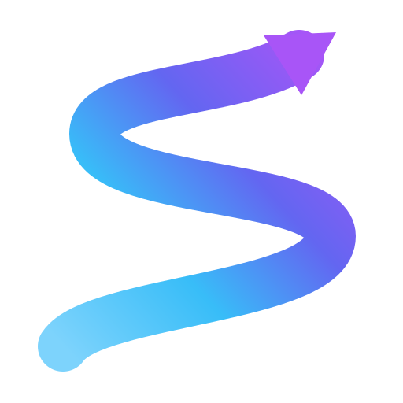

  

# Arrows

A tap-to-clear arrow puzzle game. Tap an arrow and it slithers off the board —
its head pulls away first, the body stretches out long behind it like a snake,
turning light blue into purple as it flows away, then fades. Clear every arrow
to win the level.

This is original code written for learning and side-project use, in the style
of the mobile puzzle game "Arrows". It is not a copy of that game's assets.

## How to play

- **Tap an arrow** to clear it. An arrow only clears if nothing blocks its
  exit path — if another arrow is in the way, it shakes and you lose a heart.
- You have **3 hearts** per level. Lose all 3 and the level ends.
- **3 hints** per level. A hint highlights an arrow that can clear right now.
- Clear every arrow on the board to win. Win with no hearts lost for a
  flawless win.
- **Daily Challenge**: one special board every day, tracked on a monthly
  calendar.
- **Leagues**: arrows you collect earn league points. Climb the ladder:
  Bronze (0), Silver (200), Gold (500), Diamond (1,000), Epic (2,000),
  Legendary (4,000), Master (8,000).
- **Profile**: your stats (total wins, perfect wins, flawless wins, nightmare
  wins, challenge wins, trophies, streaks, arrows collected) and awards.
- Your progress is saved in the browser (localStorage), so it survives reloads.

## Difficulty

Levels get progressively harder as you climb:

- Boards grow from 6×8 up to 10×16.
- Arrows per board grow from 6 to around 17.
- Arrows get longer and windier, with more forced turns.
- More arrows start out blocked, so you have to free them in the right order.

## How to run

No build step, no dependencies, no server needed.

1. Double-click `index.html`, or open it in any modern browser.
2. Play.

(If your browser blocks local files, serve the folder with any static server,
for example `python3 -m http.server` and open `http://localhost:8000`.)

## Files

- `index.html` — the whole game in one self-contained file (HTML, CSS, and
  JavaScript). Open it and play.
- `logo.svg` — the game logo (a slithering arrow, sky blue to purple).
- `README.md` — this file.

## Tech notes

- Single-file web app: HTML + CSS + vanilla JavaScript, no frameworks.
- Board generation is verified by simulation: generated boards are always
  solvable, and the difficulty ramp (board size, arrow count, length, turns,
  blocked share) rises steadily with the level.
- The exit animation is a "slither": the arrow follows its own winding path
  with rounded corners, the head leads and the tail follows, the body
  stretches to about 2.3× its resting length as it leaves, and it blends
  from its normal colour to light blue at the tail and purple at the head
  before fading out.
